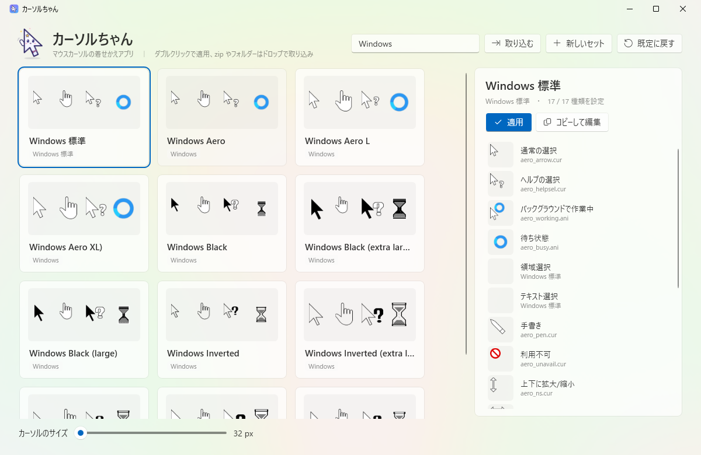

<p align="center"></p>

<h1 align="center">カーソルちゃん</h1>

<p align="center">マウスカーソルの着せかえアプリ。ギャラリーから選んで、ワンクリックで切り替え（Windows 10 / 11）</p>



## できること

- **ギャラリー** — Windows に入っているカーソル、登録済みのカーソル、自分で取り込んだセットをカードで一覧表示します。アニメーションカーソル（.ani）もそのまま動いて見えます。
- **ワンクリックで適用** — ダブルクリックか「適用」ボタンで、再起動なしにすぐ切り替わります。管理者権限はいりません。
- **かんたん取り込み** — 配布されている zip・フォルダー・`install.inf`・`.cur`/`.ani` をウィンドウにドロップするだけ。inf がなくても、ファイル名から役割を推測します（日本語の Shift_JIS の zip や inf にも対応）。
- **役割ごとに差し替え** — 「通常の選択」「リンクの選択」など 17 種類を個別に入れ替えられます。
- **画像からカーソルを作る** — PNG などの画像を選んで、クリック位置（ホットスポット）を指定するだけでカーソルになります。複数サイズ入りの .cur を作るので、大きいサイズでもきれいです。
- **サイズ変更・既定に戻す** — カーソルの大きさ（32〜256 px）の変更と、Windows 標準へのワンクリックでの戻しができます。
- コントロールパネルの「マウスのプロパティ」にも、適用したセットが表示されます。

## マスコット


矢印カーソルの姿をした「カーソルちゃん」が案内します。元データは [art/mascot.svg](art/mascot.svg) です。

- `art/render.ps1` … SVG / HTML を Edge で PNG にするスクリプト
- `art/icon.html` … アプリアイコンの元
- `art/booth-thumbnail.html` … BOOTH 用サムネイル（1200 × 1200）の元

<br clear="right">

## 動作環境

- Windows 10 / 11（64 bit）

## ダウンロード

[Releases](../../releases) から zip をダウンロードして展開し、`CursorChan.exe` を起動してください。インストールは不要です。

| ファイル | 内容 |
|---|---|
| `CursorChan-vX.Y.Z-win-x64.zip` | ふつうはこちら。そのまま動きます（約 60 MB） |
| `CursorChan-vX.Y.Z-win-x64-small.zip` | 小さい版（1 MB 未満）。[.NET 10 デスクトップ ランタイム](https://dotnet.microsoft.com/download/dotnet/10.0) が必要です |

### 「Windows によって PC が保護されました」と出たら

コード署名をしていないため、初回起動時に SmartScreen の警告が出ることがあります。「詳細情報」→「実行」で起動できます。

## データの保存場所

取り込んだセットは `%LOCALAPPDATA%\CursorChan\Library` にコピーされます。アプリを削除するときは、このフォルダーも消してください（先に「既定に戻す」を押しておくと安心です）。

## 注意

- 配布されているカーソルを取り込むときは、それぞれの作者の利用規約に従ってください。
- Windows の設定で「マウスポインターの色」をカスタムにしていると、カーソルの見た目がそちらで上書きされることがあります。

## ビルド

[.NET 10 SDK](https://dotnet.microsoft.com/download/dotnet/10.0) が必要です。

```bash
dotnet build src/CursorChan
dotnet run --project tests/Smoke          # 簡易テスト
dotnet run --project tests/Smoke -- --apply  # 実際に切り替えて元に戻すテスト
```

配布用の exe：

```bash
dotnet publish src/CursorChan -c Release -r win-x64 --self-contained true -p:PublishSingleFile=true -p:EnableCompressionInSingleFile=true -p:IncludeNativeLibrariesForSelfExtract=true -o publish
```

`v` から始まるタグ（例：`v0.1.0`）を push すると、GitHub Actions がビルドして Releases に zip を置きます。

## しくみ（開発者向け）

カーソルの設定は `HKCU\Control Panel\Cursors` にあり、ここを書き換えたあと `SystemParametersInfo(SPI_SETCURSORS)` を呼ぶと即座に反映されます。主なコードは `src/CursorChan/Core` にあります。

| ファイル | 役割 |
|---|---|
| `SystemCursors.cs` | レジストリの読み書き・適用・サイズ |
| `CursorDecoder.cs` | .cur / .ani の読み込み（プレビュー用）と、画像からの .cur 作成 |
| `SchemeImporter.cs` / `InfParser.cs` | zip・フォルダー・inf の取り込み |
| `SchemeLibrary.cs` | ライブラリ（取り込んだセット）の保存 |

## ライセンス

[MIT License](LICENSE)
